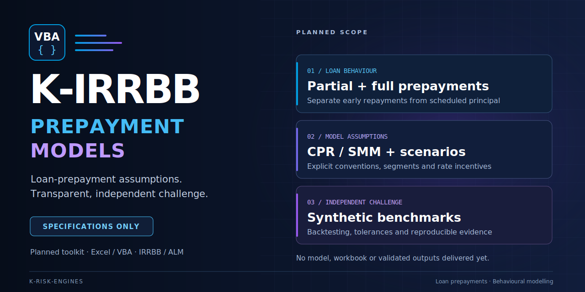

# K-IRRBB Prepayment Models



### Transparent loan-prepayment assumptions in Excel/VBA

[](docs/Milestones/v0.1.0.md)
[](INSTALLATION.md)
[](LICENSE)

[](https://github.com/danielep71/K-IRRBB-Prepayment_Models/actions/workflows/static-checks.yml)

[](docs/TRAFFIC.md) [](docs/TRAFFIC.md) [](docs/TRAFFIC.md)

**Source-first · Synthetic examples · Explicit assumptions · Reproducible evidence**

## Purpose and status

This project is intended to provide transparent tools for developing and independently challenging loan-prepayment assumptions used in IRRBB and ALM. The intended Excel/VBA workflow covers input checks, behavioural assumptions, calibration, scenarios, backtesting and controlled export of parameters or behavioural cash flows.

**Current status: repository setup only.** No prepayment model, VBA engine, workbook, calibration routine or validated numerical output is delivered. These are development objectives, not implemented features.

## Scope and boundaries

| Area | Intended scope |
| --- | --- |
| Loan prepayments | Partial and full early repayments, distinguished from scheduled principal |
| Assumptions | Explicit CPR/SMM conventions, segmentation and rate incentives, subject to agreed model contracts |
| Independent challenge | Synthetic benchmarks, documented tolerances and out-of-time validation |
| Downstream use | Controlled ALM export; model acceptance remains outside the toolkit |

This repository does not currently calculate EVE, NII, supervisory outlier tests, option values or market prices. It does not approve models or establish regulatory compliance. Deposit stability, decay and rate pass-through belong to [K-IRRBB-NMDs](https://github.com/danielep71/K-IRRBB-NMDs). Both sit within [K-Risk-Engines](https://github.com/danielep71/K-Risk-Engines).

## Navigation

| Resource | Purpose |
| --- | --- |
| [Installation](INSTALLATION.md) | Current prerequisites and checks |
| [Structure](docs/REPOSITORY_STRUCTURE.md) | Core, facade and Excel boundaries |
| [Excel evidence](docs/EXCEL_EVIDENCE.md) | What a real Excel run must record (none exists yet) |
| [Methodology contracts](docs/methodology/README.md) | Accepted data and model contracts; sources unverified, nothing implemented |
| [Foundation closeout](docs/FOUNDATION_CLOSEOUT.md) | Setup gates, NMD comparison and remaining owner steps |
| [Setup milestone](docs/Milestones/v0.1.0.md) | Issues, dependencies and completion criteria |
| [Governance](docs/GOVERNANCE.md) | Metadata, review and closure rules |
| [Contributing](CONTRIBUTING.md) | How to propose and verify changes |
| [Labels](docs/LABELS.md) | Priorities and catalogue automation |
| [VBA style](docs/VBA_HOUSE_STYLE.md) | Future implementation conventions |
| [Traffic analytics](docs/TRAFFIC.md) | Aggregate traffic history and badge definitions |
| [Tooling](tools/README.md) | Static checks and their limits |
| [Security](SECURITY.md) | Private reporting and data handling |
| [Conduct](CODE_OF_CONDUCT.md) | Participation and reporting |
| [Releasing](RELEASING.md) | Future release gates |
| [Changelog](CHANGELOG.md) | Actual, unreleased changes |

```sh
git clone https://github.com/danielep71/K-IRRBB-Prepayment_Models.git
cd K-IRRBB-Prepayment_Models
python tools/check.py
```

Git, Python 3.10+ and Node.js 22+ are needed for the offline checks. Excel is not needed. Passing them does not establish VBA compilation, Excel execution or model validity.

Every issue needs **danielep71**, a milestone and **one priority label**. Track [v0.1.0 - Repo setup](https://github.com/danielep71/K-IRRBB-Prepayment_Models/milestone/1). Use synthetic examples only: no borrower, bank, client or vendor data, credentials or proprietary models.

Original content uses [MPL-2.0](LICENSE). See [provenance](docs/PROVENANCE.md) for adaptations and the recorded ownership review.
